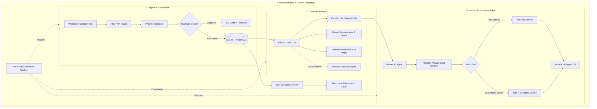

# AI-Powered Lead Management & Automation System

[](https://www.python.org/)
[](https://fastapi.tiangolo.com/)
[](https://ollama.com/)
[](https://nousresearch.com/)
[](https://n8n.io/)
[](https://gamma.app/)

> **Technical Assessment Submission**  
> **Role**: AI Automation & Integration Developer  
> **Company**: Maxsource Technologies  
> **Submission Deadline**: Within 24 Hours  

---

## 📋 Executive Summary

This repository contains the complete, production-ready implementation of the **AI-Powered Lead Management & Automation System**. The platform ingests inbound business inquiries via REST API and Webhooks, validates and deduplicates records, conducts local AI triage using **Ollama** (Hot/Warm/Cold classification, requirement extraction, and personalized response drafting), executes autonomous tool calls via a **Hermes AI Agent** (`lead_lookup` and `lead_status_update`), coordinates the complete pipeline via an **8-stage n8n workflow**, and produces executive-ready intelligence presentations via **Gamma AI**.

---

## 🏛️ System Architecture



---

## 📁 Repository Structure

```
ai-lead-automation-system/
├── backend/
│   ├── main.py                 # FastAPI REST API application
│   ├── server.py               # Standalone out-of-the-box REST API runner
│   ├── models.py               # SQLAlchemy ORM models (Lead, LeadAuditLog)
│   ├── schemas.py              # Pydantic schemas with email/phone validators
│   ├── database.py             # SQLite connection & session management
│   ├── ollama_service.py       # Ollama integration, JSON parser & circuit breaker
│   ├── hermes_agent.py         # Hermes tool-calling agent loop
│   └── tools.py                # Agent tools: lead_lookup & lead_status_update
├── n8n/
│   ├── lead_management_workflow.json  # Exported 8-stage n8n workflow
│   └── workflow_guide.md       # Detailed node-by-node architectural guide
├── ollama/
│   ├── Modelfile               # Custom tuned model configuration for lead triage
│   └── setup_ollama.md         # Ollama installation, pull & execution instructions
├── gamma/
│   ├── gamma_presentation_prompt.md  # Ready-to-paste prompt for Gamma.app
│   └── sample_lead_data.json   # 15 realistic B2B test leads with metrics
├── docs/
│   ├── PROBLEM_SOLVING_CHALLENGES.md # Exhaustive solutions to the 6 challenges
│   ├── SCREEN_RECORDING_CHECKLIST.md # Step-by-step video recording guide
│   └── INTERVIEW_PREP_GUIDE.md # Technical defense cheat sheet for interview
├── tests/
│   ├── test_api.py             # Validation, duplicate prevention & CRUD tests
│   ├── test_agent.py           # Hermes agent reasoning & tool failure tests
│   └── seed_data.py            # Automated seed script for 15 realistic B2B leads
├── run_demo.py                 # 1-Click interactive terminal demo
├── requirements.txt            # Python dependencies
├── .env.example                # Sample environment variables
└── README.md                   # Project documentation
```

---

## 🚀 Quickstart & Execution

### 1. Clone & Set Up Environment
```bash
git clone https://github.com/your-username/ai-lead-automation-system.git
cd ai-lead-automation-system

# Create and activate virtual environment
python -m venv venv
# Windows:
.\venv\Scripts\activate
# Linux/Mac:
source venv/bin/activate

# Install dependencies
pip install -r requirements.txt
```

### 2. Run Interactive End-to-End Demo (Task 1 to 5)
Experience the complete pipeline in seconds:
```bash
python run_demo.py
```

### 3. Run Automated Unit & Integration Tests
```bash
python -m unittest discover -s tests -v
```
*Expected: 9/9 tests pass (covering validation, duplicate prevention, status transitions, tool calling, and failure recovery).*

### 4. Start the REST API Server
```bash
# Option A: Standalone Runner (No extra dependencies needed)
python backend/server.py

# Option B: FastAPI / Uvicorn (with interactive Swagger docs at http://localhost:8000/docs)
uvicorn backend.main:app --reload --port 8000
```

---

## 📡 REST API Reference

| Method | Endpoint | Description | Status Code |
| :--- | :--- | :--- | :--- |
| `POST` | `/api/leads` | Ingests new lead; validates email & phone; enforces duplicate prevention. | `201 Created` / `409 Conflict` |
| `GET` | `/api/leads` | Lists stored leads with optional `status` or `classification` filter. | `200 OK` |
| `GET` | `/api/leads/{id}` | Retrieves a single lead's full profile and history. | `200 OK` / `404 Not Found` |
| `PATCH` | `/api/leads/{id}/status` | Updates pipeline status with required audit reason and actor name. | `200 OK` / `400 Bad Request` |
| `POST` | `/api/leads/{id}/analyze` | Runs Ollama AI classification, requirement extraction, and email drafting. | `200 OK` |
| `POST` | `/api/agent/execute` | Executes natural language instructions via Hermes tool-calling agent. | `200 OK` |
| `POST` | `/api/webhook/leads` | Automated webhook pipeline designed for n8n integration. | `200 OK` |
| `GET` | `/api/stats/summary` | Aggregated metrics for Gamma AI presentation generation. | `200 OK` |
| `GET` | `/health` | Healthcheck endpoint. | `200 OK` |

---

## 🤖 Task 2: Ollama AI Integration

### Classification Logic
- **🔥 Hot Lead**: Explicit purchase intent, approved budget, urgent timeline (< 30 days), requests for demo or pricing.
- **🌤️ Warm Lead**: Researching features, evaluating vendors, requesting technical whitepapers or trials.
- **❄️ Cold Lead**: Low-priority generic queries, recruitment solicitations, SEO spam, student homework.

### Resilient Circuit Breaker
If Ollama is offline or times out, the system automatically engages `_fallback_heuristic_analyzer` (`backend/ollama_service.py`), ensuring **100% pipeline uptime and zero lead drops**.

---

## 🧠 Task 3: Hermes AI Agent

The Hermes Agent is equipped with two production-grade tools:
1. `lead_lookup(lead_id, email)`: Retrieves lead details, historical interactions, and status.
2. `lead_status_update(lead_id, new_status, reason)`: Validates status transitions (`New`, `Contacted`, `Qualified`, `Disqualified`) and logs an immutable audit trail.

### Example Agent Execution
```json
// POST /api/agent/execute
{
  "instruction": "Look up lead #1 and if they are a Hot Lead, update status to Qualified because they approved a $50k budget.",
  "lead_id": 1
}
```
**Agent Response**:
```json
{
  "instruction": "Look up lead #1...",
  "agent_reasoning": "User requested to update lead 1 to status 'Qualified'. Selected tool 'lead_status_update'.",
  "tool_executed": "lead_status_update",
  "tool_input": {
    "lead_id": 1,
    "new_status": "Qualified",
    "reason": "they approved a $50k budget."
  },
  "final_response": "Successfully executed lead status update. Lead #1 status transitioned from 'New' to 'Qualified'. Reason recorded: 'they approved a $50k budget.'.",
  "success": true
}
```

### Handled Tool Failure Demonstration
If an instruction references an invalid lead (e.g. ID #99999), the tool returns `error_code: "LEAD_NOT_FOUND"`. Hermes handles the observation gracefully and notifies the user without corrupting system state.

---

## ⚡ Task 4: n8n Workflow Automation

The complete 8-stage pipeline is defined in `n8n/lead_management_workflow.json`:
1. **Webhook Node**: Receives incoming lead payload (`POST /webhook/leads`).
2. **Payload Validation**: Validates required fields and email regex.
3. **Duplicate Check**: Verifies existence via API; catches 409 Conflict.
4. **Ollama Analysis**: Dispatches message for classification and response drafting.
5. **Hermes Agent Step**: Executes agent reasoning to update lead pipeline status.
6. **Save Status**: Persists new status and audit log.
7. **Generate Response**: Emits structured JSON webhook confirmation.
8. **Global Error Trigger**: Captures unhandled node failures and triggers alerts.

---

## 📊 Task 5: Gamma AI Presentation

Using actual data from our 15 test leads generated in `tests/seed_data.py`:
- **Total Leads Processed**: 15
- **Hot Leads**: 5 (33.3%) $\rightarrow$ Auto-Qualified
- **Warm Leads**: 4 (26.7%) $\rightarrow$ Auto-Contacted
- **Cold Leads**: 6 (40.0%) $\rightarrow$ Auto-Disqualified
- **Slide Deck Guide**: See `gamma/gamma_presentation_prompt.md` to paste into [Gamma.app](https://gamma.app) and generate the deck in 60 seconds.

---

## 💡 Section 3: Problem-Solving Challenges

Comprehensive, code-referenced answers for all 6 scenarios are documented in [`docs/PROBLEM_SOLVING_CHALLENGES.md`](docs/PROBLEM_SOLVING_CHALLENGES.md):
1. **Ollama Unavailable**: Circuit breaker with heuristic NLP fallback and `_source` tracking.
2. **Duplicate Lead Prevention**: Multi-layered check (SQLAlchemy unique constraint + pre-flight check + 409 Conflict routing in n8n).
3. **Invalid JSON from AI**: 3-tier resilient JSON extraction pipeline (direct parse, regex markdown extractor, substring brace delimiter).
4. **API Timeouts**: Explicit HTTP client timeout thresholds (20s) and asynchronous 202 Accepted worker queue architecture.
5. **Unauthorized Agent Actions**: Strict tool whitelisting (zero raw SQL or system commands), status enum state-machine validation, and immutable audit logging.
6. **100 Simultaneous Leads**: Asynchronous message queues (Redis / Celery), concurrency rate limiting (`OLLAMA_NUM_PARALLEL`), connection pooling, and horizontal inference scaling.

---

## 🎥 Screen Recording & Submission Checklist

Follow [`docs/SCREEN_RECORDING_CHECKLIST.md`](docs/SCREEN_RECORDING_CHECKLIST.md) to record the required walkthrough video:
1. Code structure in VS Code.
2. Unit tests passing (`python -m unittest discover -s tests -v`).
3. REST server running (`python backend/server.py`).
4. Duplicate prevention demonstration via curl.
5. Ollama AI analysis demonstration.
6. Hermes Agent tool execution & error handling demonstration.
7. n8n workflow visual inspection.
8. Gamma AI deck presentation.
9. Upload recording to Google Drive with **"Anyone with the link can view"** permissions.
