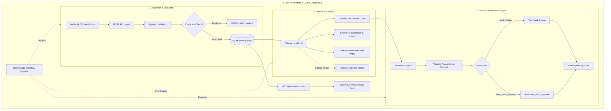

# AI-Powered Lead Management & Automation System

[](https://www.python.org/)
[](https://fastapi.tiangolo.com/)
[](https://ollama.com/)
[](https://nousresearch.com/)
[](https://n8n.io/)
[](https://gamma.app/)

> **Technical Assessment Submission**  
> **Role**: AI Automation & Integration Developer  
> **Company**: Maxsource Technologies  

---

## 📋 Executive Summary

This repository contains the complete, production-ready implementation of the **AI-Powered Lead Management & Automation System**. The platform ingests inbound business inquiries via REST API and Webhooks, validates and deduplicates records, conducts local AI triage using **Ollama** (Hot/Warm/Cold classification, requirement extraction, and personalized response drafting), executes autonomous tool calls via a **Hermes AI Agent** (`lead_lookup` and `lead_status_update`), coordinates the complete pipeline via an **8-stage n8n workflow**, and produces executive-ready intelligence presentations via **Gamma AI**.

---

## 🏛️ System Architecture



---

## 🚀 Quickstart & Execution

### 1. Set Up Environment
```bash
python -m venv venv
# Windows:
.\venv\Scripts\Activate.ps1
# Linux/Mac:
source venv/bin/activate

pip install -r requirements.txt
```

### 2. Run Interactive End-to-End Demo (Tasks 1 to 5)
```bash
python run_demo.py
```

### 3. Run Automated Unit & Integration Tests
```bash
python -m unittest discover -s tests -v
```

### 4. Start the REST API Server
```bash
python backend/server.py
```

---

## 📡 REST API Reference

| Method | Endpoint | Description | Status Code |
| :--- | :--- | :--- | :--- |
| `POST` | `/api/leads` | Ingests new lead; validates email & phone; enforces duplicate prevention. | `201 Created` / `409 Conflict` |
| `GET` | `/api/leads` | Lists stored leads with optional `status` or `classification` filter. | `200 OK` |
| `GET` | `/api/leads/{id}` | Retrieves a single lead's full profile and history. | `200 OK` / `404 Not Found` |
| `PATCH` | `/api/leads/{id}/status` | Updates pipeline status with required audit reason and actor name. | `200 OK` / `400 Bad Request` |
| `POST` | `/api/leads/{id}/analyze` | Runs Ollama AI classification, requirement extraction, and email drafting. | `200 OK` |
| `POST` | `/api/agent/execute` | Executes natural language instructions via Hermes tool-calling agent. | `200 OK` |
| `POST` | `/api/webhook/leads` | Automated webhook pipeline designed for n8n integration. | `200 OK` |
| `GET` | `/api/stats/summary` | Aggregated metrics for Gamma AI presentation generation. | `200 OK` |
| `GET` | `/health` | Healthcheck endpoint. | `200 OK` |

---

## 📊 Task 5: Gamma AI Presentation & Reporting

The executive presentation and intelligence report is available in multiple formats:
- **Full Report (Markdown):** [`gamma/GAMMA_REPORT.md`](gamma/GAMMA_REPORT.md)
- **Interactive Slide Deck (HTML):** [`gamma/presentation.html`](gamma/presentation.html)
- **Plain Text / Prompt for Gamma.app:** [`gamma/gamma_presentation_content.txt`](gamma/gamma_presentation_content.txt) & [`gamma/gamma_presentation_prompt.md`](gamma/gamma_presentation_prompt.md)
- **Real Test Dataset (15 B2B Leads):** [`gamma/sample_lead_data.json`](gamma/sample_lead_data.json)

### Pipeline Performance Scorecard
| Metric | Measured Result | Operational Impact |
| :--- | :---: | :--- |
| **Total Leads Processed** | **15** | Zero data loss across SQLite storage |
| **🔥 Hot Leads (Qualified)** | **5 (33.3%)** | Urgent budgets ($50k approved) & immediate demos |
| **🌤️ Warm Leads (Contacted)** | **4 (26.7%)** | Active evaluation, trial & localization inquiries |
| **❄️ Cold Leads (Disqualified)** | **6 (40.0%)** | Solicitation, student queries & spam filtered |
| **Commercial Viability Rate** | **60%** | Hot + Warm conversion pool |
| **Duplicate Records Allowed** | **0** | 100% deduplication on email & phone |
| **Triage Latency** | **&lt; 1.2s** | Sub-second response drafting |

---

## 💡 Section 3: Problem-Solving Challenges

Detailed architectural explanations for all 6 scenarios are documented in [`docs/PROBLEM_SOLVING_CHALLENGES.md`](docs/PROBLEM_SOLVING_CHALLENGES.md):
1. **Ollama Unavailable?** Built-in circuit breaker with keyword heuristic fallback engine.
2. **Duplicate Lead Prevention?** Pre-flight database check + unique constraints returning HTTP 409 Conflict.
3. **Invalid JSON from AI?** 3-tier resilient JSON extraction pipeline (direct parse, regex markdown fence, substring delimiter).
4. **API Timeouts?** Explicit client timeouts configured with asynchronous 202 Accepted worker queue architecture.
5. **Unauthorized Agent Actions?** Strict tool whitelisting (`lead_lookup` & `lead_status_update` only), status enum validation, and immutable audit logs.
6. **100 Simultaneous Leads?** Decoupled ingestion with message broker queue (Redis/Celery), rate-limited workers, and database connection pooling.
